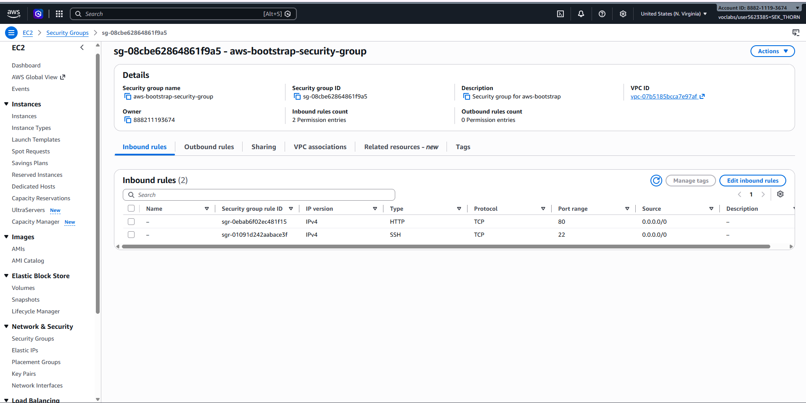
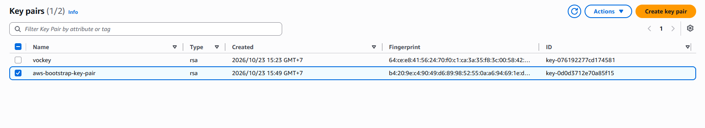
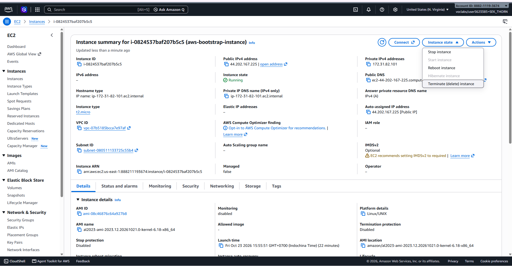
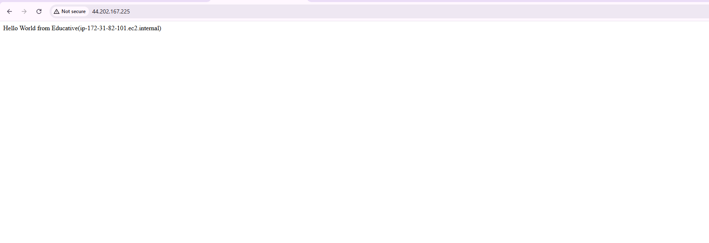
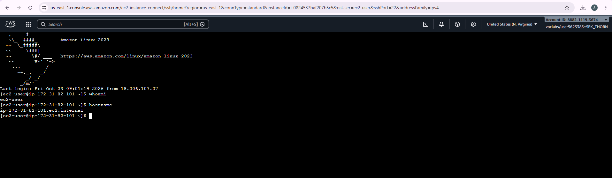
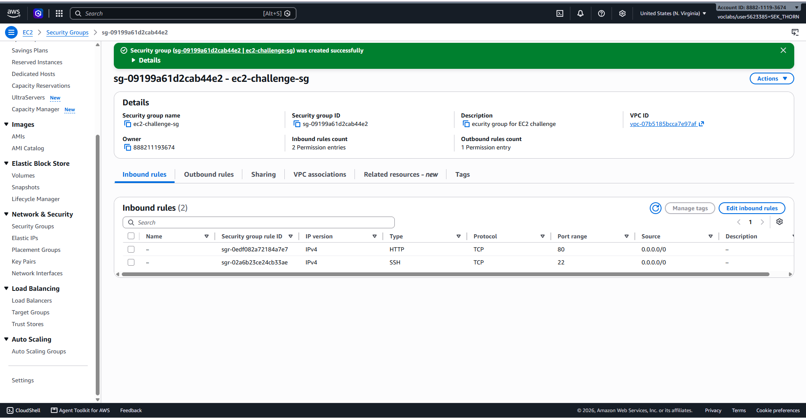
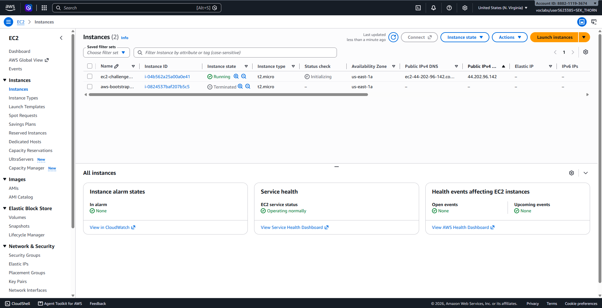
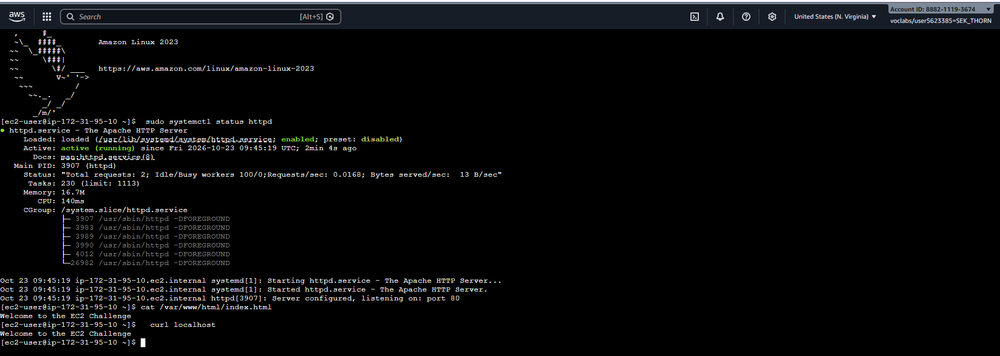
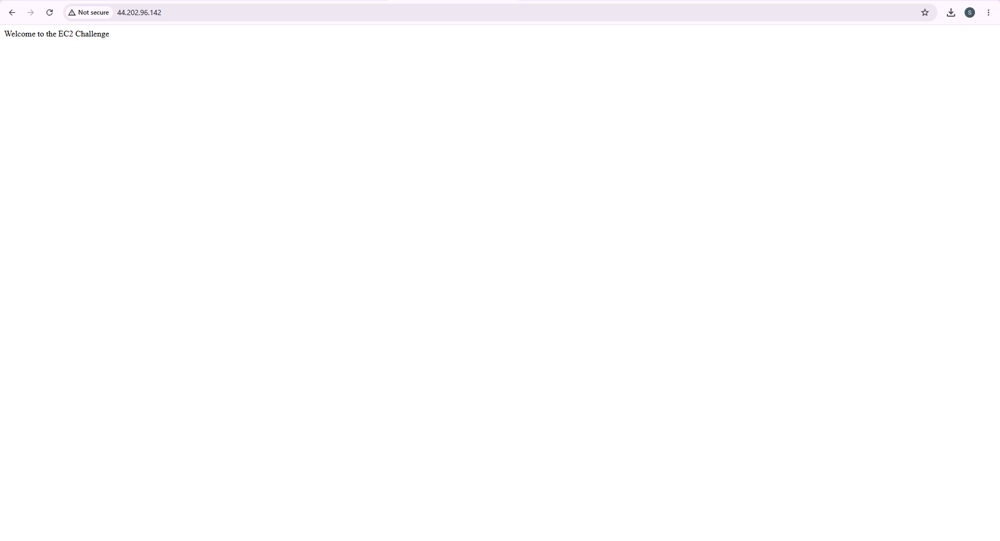

# Cloud Lab 1 Submission — Amazon EC2

* Student name: Sek Thorn
* Student ID: e20220341
* Learner Lab user name: voclabs/user5623385=SEK_THORN
* Date completed: 10/23/2026

## Part 1.1 — An Amazon EC2 Walkthrough

### Security group


### Key pair


### Instance details


### Browser test


### SSH connection


**Did you connect with your own SSH client or with EC2 Instance Connect?**

I connected with **EC2 Instance Connect** (Connect > EC2 Instance Connect in the console). I used it instead of my own SSH client, so no private key file was needed on my computer. `whoami` returned `ec2-user` and `hostname` returned `ip-172-31-82-101.ec2.internal`.

## Part 1.2 — EC2 Web Solution (Challenge)

### Launch configuration


### Security group


### Running instance


### Commands on the instance


Paste the commands you ran to install the web server and create `index.html`:

```bash
# User data script (ran automatically at first boot)
#!/bin/bash
dnf install -y httpd
systemctl start httpd
systemctl enable httpd
echo "Welcome to the EC2 Challenge" > /var/www/html/index.html

# Verification commands I typed in EC2 Instance Connect
sudo systemctl status httpd
cat /var/www/html/index.html
curl localhost
```

### Browser test


The page at `http://44.202.96.142` shows "Welcome to the EC2 Challenge".

## Questions

1. **Your security group has an SSH rule and an HTTP rule. What does each one let you do? What would stop working if you deleted the HTTP rule?**

   The SSH rule (TCP port 22) lets me connect to the instance's terminal remotely, either with an SSH client or EC2 Instance Connect, so I can run commands on it. The HTTP rule (TCP port 80) lets a browser reach the web server and load the page. If I deleted the HTTP rule, the web page would stop loading and the browser would time out, because the security group would block port 80. SSH would still work, and Apache would still be running on the instance.

2. **In Part 1.1 you never logged in to install the web server. What installed it, and when did it run?**

   The **user data** script installed it. It is a bootstrap script I pasted into Advanced details when launching the instance. The instance runs it automatically (through cloud-init) **once, at first boot**, with administrator rights. It updated the system, installed `httpd`, started and enabled the service, and created `index.html`.

3. **Why does the web page open with `http://` but not with `https://`?**

   The web server only serves plain HTTP on port 80. HTTPS needs port 443, an SSL/TLS certificate, and Apache configured for it. None of those exist, and the security group only opens ports 22 and 80. A request to `https://` therefore fails.

4. **Part 1.2 asked for a 10 GiB root volume. Where in the launch settings did you set it, and how can you check the size on the running instance?**

   I set it in **Configure storage** on the Launch instance page by changing the root volume size from 8 to 10 GiB (gp3). To check it on the running instance, I can open the instance's **Storage** tab in the EC2 console and look at the volume size. Inside the instance, I can run `lsblk` or `df -h` to see the size of the root disk.

## Problems and how I solved them (optional)

* **Rules in the wrong place:** In Part 1.1 I first added the SSH and HTTP rules under *Outbound rules*. They have to go under *Inbound rules*, and the outbound section keeps the default All traffic rule. I fixed it before creating the group.
* **Browser timeout:** The first test of the web page timed out (`ERR_CONNECTION_TIMED_OUT`). A timeout points to the firewall rather than Apache, so I checked the security group and its inbound rules. The page loaded after that.
* **Connect button greyed out:** The Connect button was disabled because no instance was ticked. I ticked the instance and it became active.
* **Wrong security group at launch:** In Part 1.2 the launch wizard defaulted to *Create security group* (`launch-wizard-1`). I switched to *Select existing security group* and chose `ec2-challenge-sg`.
* **Key pair not downloaded again:** AWS gives the `.pem` file only once. Because of that, I used EC2 Instance Connect for the SSH step.

## AI note (optional)

An AI tool suggested that an `ERR_CONNECTION_TIMED_OUT` error usually means the security group is blocking traffic, rather than Apache being down (which would give "connection refused"). I checked this by opening the instance's Security tab and confirming the attached group and its inbound rules for ports 22 and 80. After the rules were right, the page loaded.

## Clean up

* Part 1.1: instance terminated, key pair and security group deleted.
* Part 1.2: instance terminated, security group (and key pair, if any) deleted.
