# Cloud Lab 2 — Attach an Application Load Balancer to an EC2 Auto Scaling Group

| Item | Details |
|---|---|
| Student ID | e20220341 |
| AWS user | `voclabs/user5623385=SEK_THORN` (AWS Academy Learner Lab) |
| Region | US East (N. Virginia) `us-east-1` |
| Technologies | Elastic Load Balancing (Application Load Balancer), Amazon EC2 Auto Scaling, Amazon EC2 |

## 1. Overview

In this lab I built a small highly available web tier on AWS. An Internet-facing Application Load Balancer receives HTTP requests and forwards them to EC2 instances that an Auto Scaling group launches from a launch template. I then tested load balancing in the browser, stopped the web server on one instance, and watched the load balancer detect the failure while the Auto Scaling group replaced the instance.

## 2. Key concepts

**Load balancer.** A load balancer is the single entry point for clients. It receives a request, evaluates its listener rules, picks a healthy registered target and forwards the request. An *Application Load Balancer* works at layer 7 (HTTP/HTTPS); a *Network Load Balancer* works at layer 4.

**Listener.** A listener checks for connection requests on a protocol and port (here HTTP:80) and applies rules. My default rule forwards all traffic to the target group.

**Target group.** A logical group of targets (here EC2 instances) that receive traffic from the load balancer. It also owns the health check settings.

**Health check.** The target group periodically requests a path on each target and only keeps targets in service that answer correctly. My settings: protocol HTTP, path `/`, interval 30 s, timeout 5 s, success code 200, unhealthy threshold 2 consecutive failures, healthy threshold 5 consecutive successes.

**Launch template.** A reusable definition of how to launch an instance (AMI, instance type, security group, user data).

**Auto Scaling group (ASG).** Keeps the desired number of instances running (desired 2, min 2, max 3) and, with ELB health checks enabled, replaces instances that the load balancer reports as unhealthy.

## 3. Task 1 — Security groups

I created two security groups in the default VPC (`vpc-07b5185bcca7e97af`):

- `LoadBalancerSecurityGroup` (`sg-01e1f0dfc9f8b3861`): inbound HTTP 80 from `0.0.0.0/0`. This lets clients reach the load balancer.
- `LaunchTemplateSecurityGroup` (`sg-042c538fea78372f7`): inbound HTTP 80 and SSH 22 from `0.0.0.0/0`. HTTP serves the web page; SSH allows EC2 Instance Connect.

**Screenshot 01 — `LoadBalancerSecurityGroup` inbound rule**

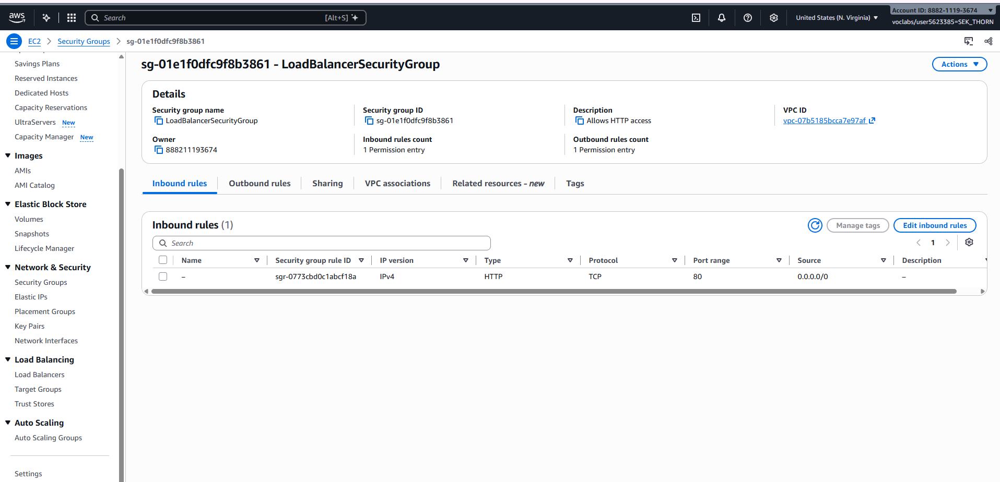

**Screenshot 02 — `LaunchTemplateSecurityGroup` inbound rules**

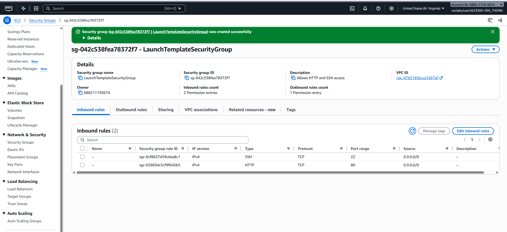

## 4. Task 2 — Target group

I created `LoadBalancerTargetGroup` with target type *Instances*, protocol HTTP, port 80, in the default VPC. I kept the default health check settings and registered no targets, because the Auto Scaling group registers instances automatically.

**Screenshot 03 — Target group details**

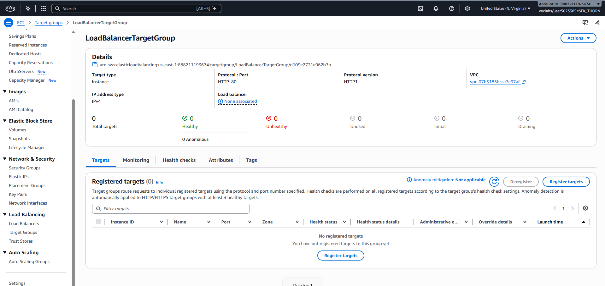

**Screenshot 04 — Health checks** (path `/`, interval 30 s, timeout 5 s, unhealthy threshold 2, healthy threshold 5, success code 200)

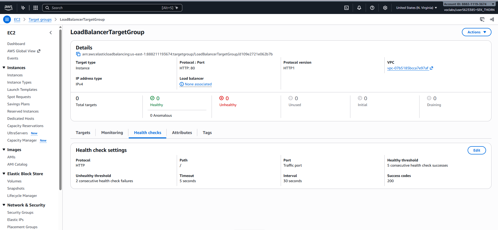

With these settings, each instance's root page is requested every 30 seconds. Any answer other than 200 counts as a failed check, and two failed checks in a row mark the instance *unhealthy*.

## 5. Task 3 — Application Load Balancer

I created `MyLoadBalancer`: Internet-facing, IPv4, default VPC, mapped to all 6 Availability Zones, with security group `LoadBalancerSecurityGroup` and a listener HTTP:80 that forwards to `LoadBalancerTargetGroup`. After provisioning, its state became *Active*. Its DNS name is `MyLoadBalancer-2010243260.us-east-1.elb.amazonaws.com`.

**Screenshot 05 — Load balancer list (Active)**

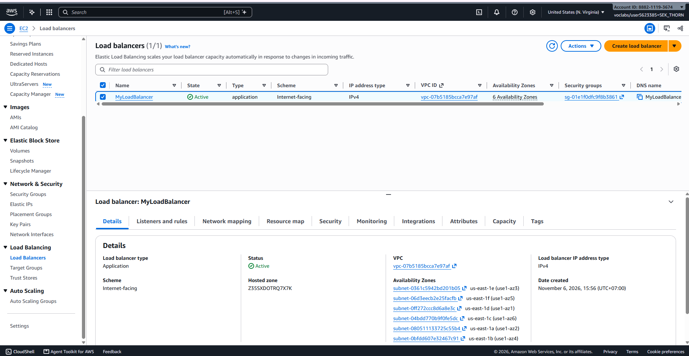

**Screenshot 06 — Details: Internet-facing scheme and attached security group**

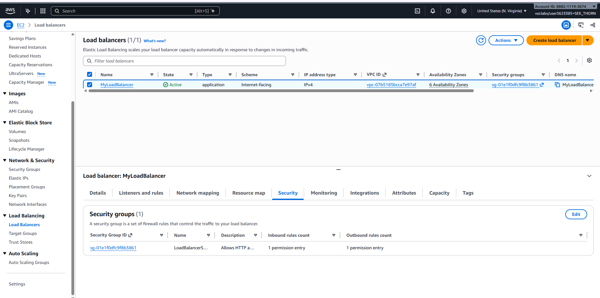

## 6. Task 4 — Launch template and Auto Scaling group

**Launch template** `AutoScalingLaunchTemplate` (`lt-0cc7c31dc7b552894`): Amazon Linux 2023 (`ami-08c46876c64a927b8`, `al2023-ami-2023.12.20261021.0-kernel-6.18-x86_64`), instance type `t2.micro`, security group `LaunchTemplateSecurityGroup`. The user data installs Apache httpd, starts and enables it, and writes `Hello World from ($(hostname))` to `/var/www/html/index.html`, so each instance shows its own host name.

**Screenshot 07 — Launch template: AMI, instance type, security group**

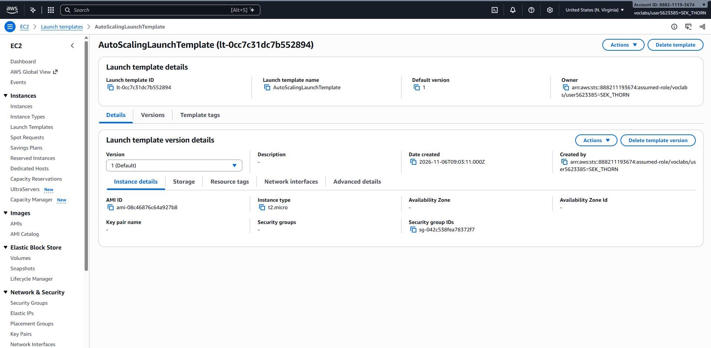

**Screenshot 07b — Launch template: user data script (Advanced details)**

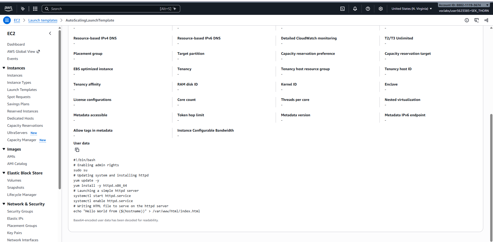

**Auto Scaling group** `MyAutoScalingGroup`: uses the launch template, all 6 subnets of the default VPC, attached to `LoadBalancerTargetGroup`, Elastic Load Balancing health checks turned on, desired capacity 2, minimum 2, maximum 3.

**Screenshot 08 — Auto Scaling group list (2 instances, 2/2 healthy)**

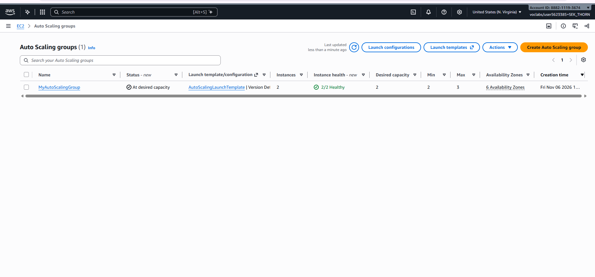

**Screenshot 09 — ASG details: capacity 2 / 2–3 and the attached target group**

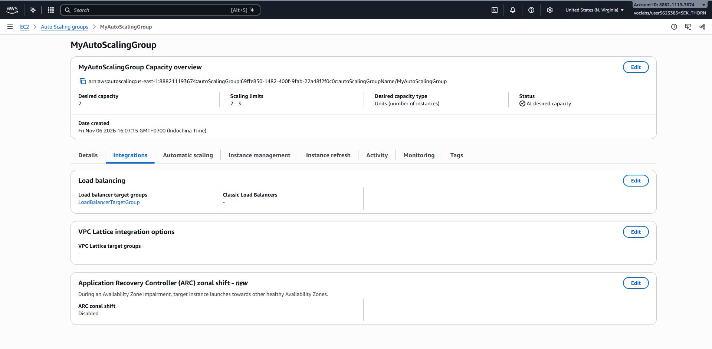

## 7. Task 5 — Testing

### Load balancing

Once both targets were *Healthy* (`i-03cc8375526fa8fa4` in us-east-1f and `i-0710533be21b7483b` in us-east-1b), I opened the load balancer's DNS name over HTTP. The first response came from `ip-172-31-79-243.ec2.internal`. After opening a new session, the same address returned a response from `ip-172-31-31-236.ec2.internal`, which shows that the load balancer distributes requests across both instances.

**Screenshot 10 — First response (host `ip-172-31-79-243`)**


**Screenshot 11 — Same address, different host (`ip-172-31-31-236`)**


### Simulated application failure

I connected to instance `i-03cc8375526fa8fa4` (`ip-172-31-79-243`) with EC2 Instance Connect and stopped the web server:

```bash
sudo systemctl stop httpd.service
```

**Screenshot 12 — Terminal after stopping httpd**

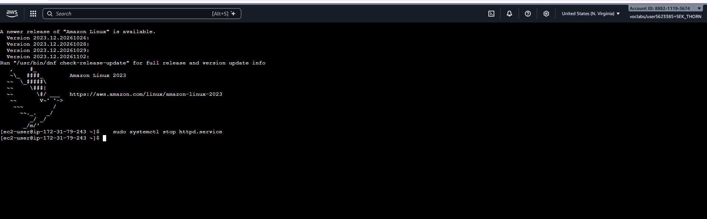

The instance kept running, but its application no longer answered. While the load balancer still sent some requests to it, the browser showed **502 Bad Gateway**. After the health checks failed, the target group marked the instance unhealthy and began deregistering it (state *Draining*, "Target deregistration in progress"). The Auto Scaling group launched a replacement instance, `i-0db720e2d077ecfb4`, which first showed *Unhealthy* ("Health checks failed") while it booted and installed httpd.

**Screenshot 13 — Failed target *Draining*, replacement being started**

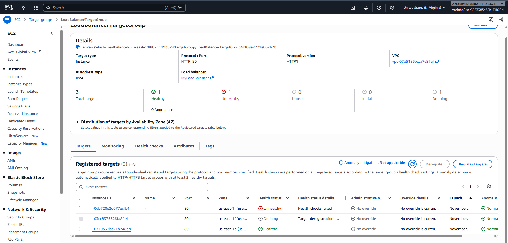

After the replacement passed its health checks, the target group showed 2 healthy targets again: the original `i-0710533be21b7483b` and the new `i-0db720e2d077ecfb4`.

**Screenshot 14 — Replacement instance *Healthy***

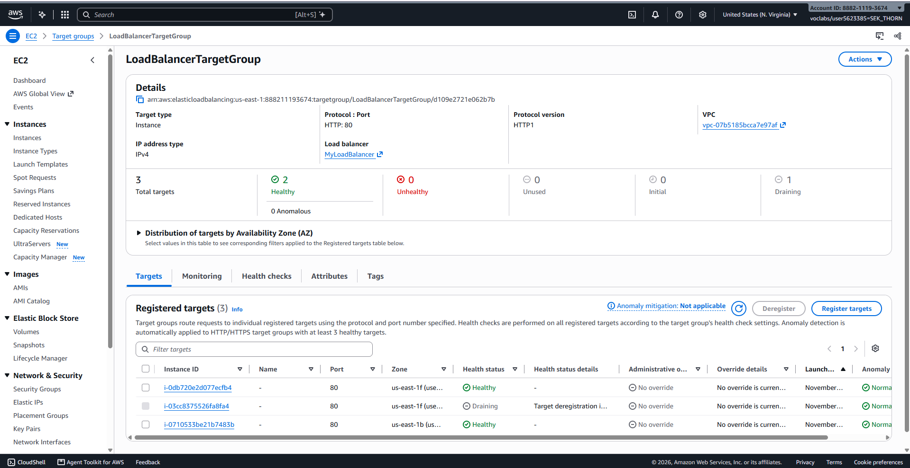

## 8. Task 6 — Clean up

After taking all screenshots, I deleted the resources in reverse order of creation: Auto Scaling group, launch template, load balancer, target group, and both security groups. All instances were terminated, and only the VPC's `default` security group remained.

## 9. Conclusion

The Application Load Balancer checks the *application*, not just the instance: stopping httpd made the instance fail its health checks even though the EC2 instance was still running. Because the Auto Scaling group used ELB health checks, it replaced the failed instance automatically and restored the desired capacity of 2 healthy targets without manual action. This combination gives a self-healing web tier spread over several Availability Zones.
